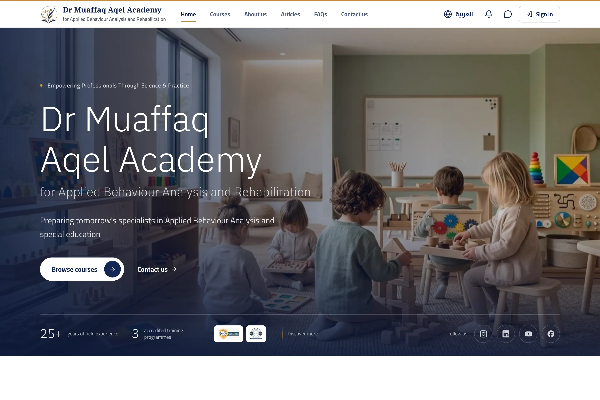

# Aqel Academy

A bilingual (Arabic and English) platform for Dr Muaffaq Aqel's academy of Applied Behaviour Analysis. It replaced the academy's WordPress site: students book a seat in a course, the doctor approves it from a simple dashboard, and they talk through in-app messages.

**Live:** [aqelacademy.com](https://aqelacademy.com)

## Highlights

- Arabic (right to left) and English, with statically rendered pages and pre-built images
- Bookings with approval, messages, notifications and email
- Sign-in with email codes or Google, captcha, and Row Level Security on every table, tested in CI
- Runs entirely on free tiers, with daily encrypted backups

## Stack

Next.js 16 · React 19 · TypeScript · Tailwind CSS 4 · Supabase · Cloudflare Workers

Setup and operations are in [docs/operations.md](docs/operations.md).
